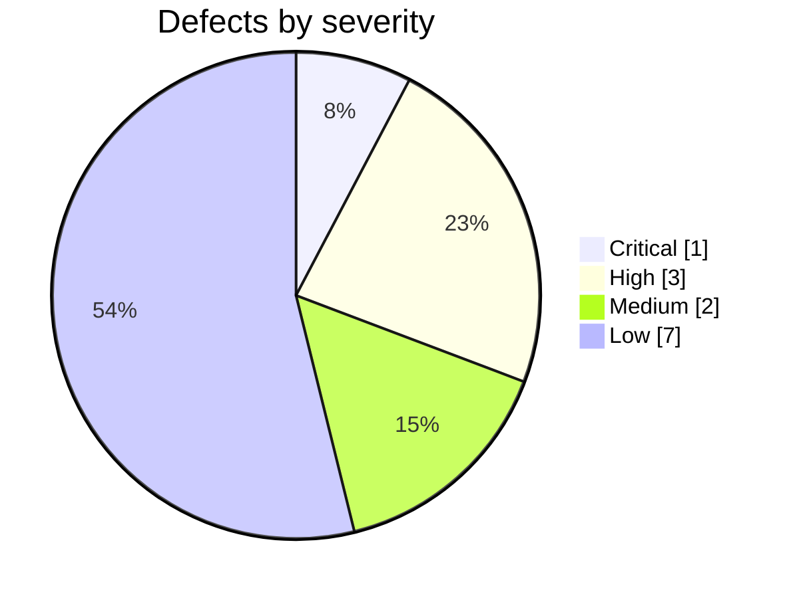
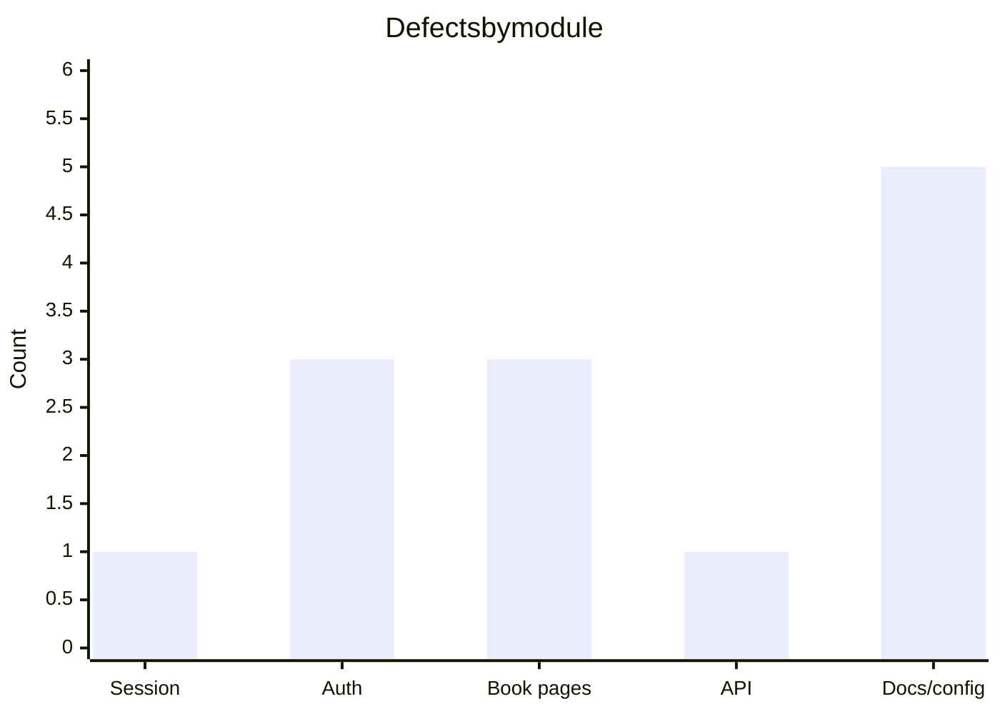

# Defect Statistics

We found 13 defects: 1 critical, 3 high, 2 medium and 7 low. The critical one is the hardcoded session secret; the high ones are plain-text passwords, raw regex in the search box, and invalid ObjectIds on the book pages. Most of the low ones are documentation or configuration leftovers. The two charts below show the split by severity and by module.

The repository has 230 commits and 76 merges, many of them small single-file patches. That is how most of the low-severity defects were left behind: a fix landed in one file and nobody went back to check the README or the matching view. The book pages have the most runtime defects because that is where user input first enters the system.
