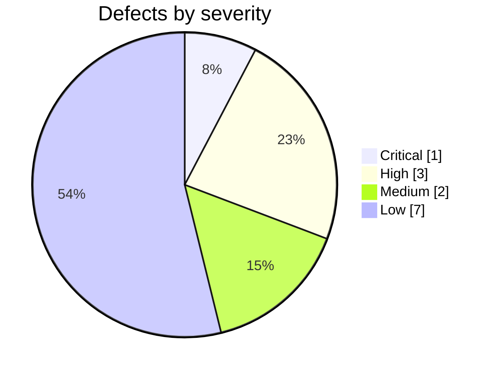
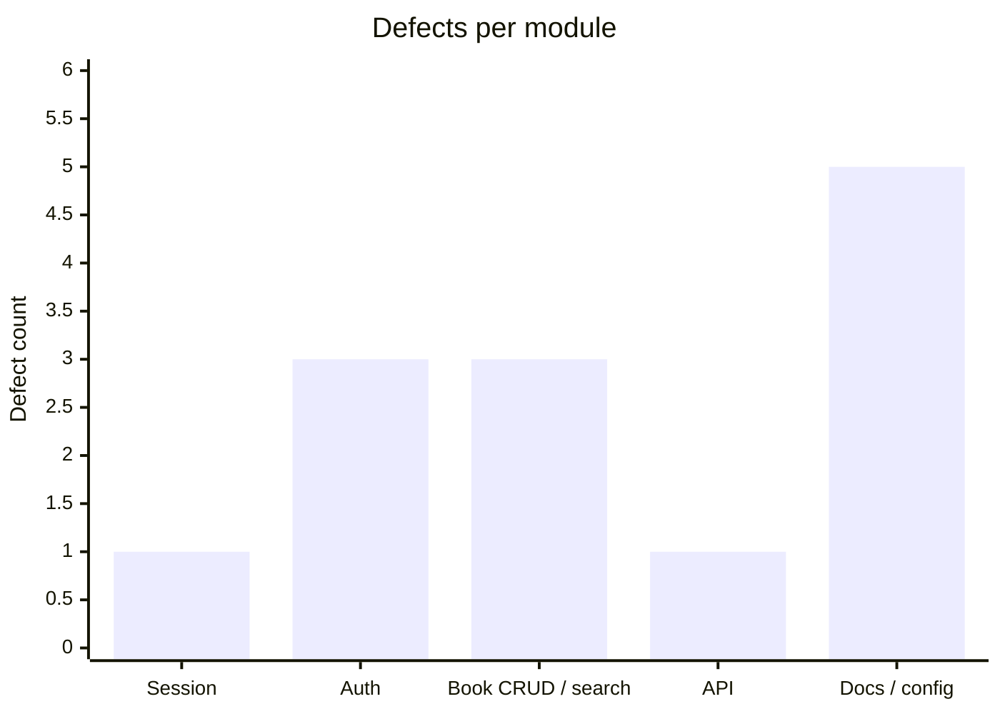
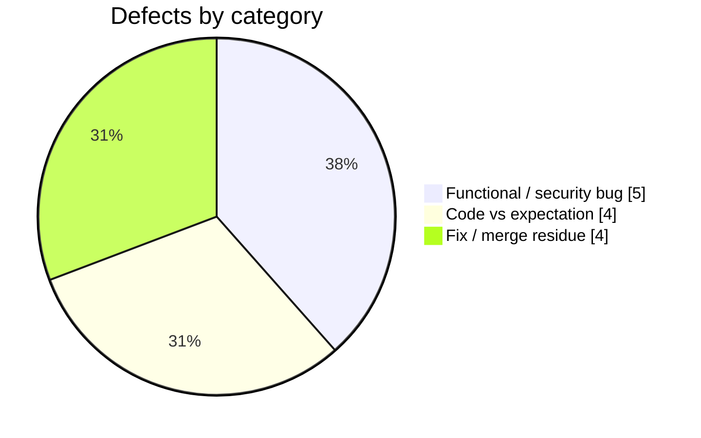

# Defect Statistics

This file groups the 13 confirmed defects by severity, by module and by origin. Charts use Mermaid, which renders directly in GitHub's Markdown viewer.

## Defect register (D-01 … D-13)

| ID | Defect | Severity | Module |
| --- | --- | --- | --- |
| D-01 | Hardcoded fallback session secret allows cookie forgery | Critical | Session / config |
| D-02 | Passwords stored and compared as plain text | High | Auth / data model |
| D-03 | Raw regex from search box causes 500 on malformed pattern | High | Book search |
| D-04 | Invalid ObjectId on book edit/delete returns 500 with raw stack text | High | Book CRUD |
| D-05 | Mongoose validation errors on book create surface as 500 | Medium | Book CRUD |
| D-06 | `next` redirect parameter dropped by login form | Medium | Auth / view |
| D-07 | `/api/*` 503 guard runs before 404, so unknown API paths return 503 when DB is down | Low | API routing |
| D-08 | Sign-up password field is `type="text"` | Low | Auth / view |
| D-09 | `package.json` `"main": "index.js"` but no such file | Low | Project config |
| D-10 | README curl examples use an invalid 18-character ObjectId | Low | Documentation |
| D-11 | SECURITY.md is an untouched template with fictional versions | Low | Documentation |
| D-12 | `.env.example` still documents removed Facebook OAuth | Low | Documentation / config |
| D-13 | README "Scope" section lists exclusions as if they were features | Low | Documentation |

## By severity

| Severity | Count | IDs |
| --- | --- | --- |
| Critical | 1 | D-01 |
| High | 3 | D-02, D-03, D-04 |
| Medium | 2 | D-05, D-06 |
| Low | 7 | D-07 … D-13 |

The shape is typical of a student MVP: one serious design shortcut in the session layer, a few rough edges in input handling, and a longer tail of small documentation and configuration issues that never got cleaned up.

## By functional module

| Module | Defects | Case IDs that failed |
| --- | --- | --- |
| Session / config | 1 (D-01) | U-11 |
| Auth and login views | 3 (D-02, D-06, D-08) | U-09, U-10, U-11 |
| Book CRUD and search | 3 (D-03, D-04, D-05) | B-06, B-07, B-09, B-10, B-11 |
| API routing | 1 (D-07) | P-10 |
| Documentation / config | 5 (D-09 … D-13 plus D-10) | P-11, setup notes |

Book CRUD/search and documentation are the two noisiest areas. The first is where most user input enters the system; the second grew one patch at a time through 35+ README commits without a final proofread.

## By category: minor bug vs. expectation gap vs. fix/merge residue

The brief asked us to separate small bugs, places where the code differs from what the README leads you to expect, and things left behind by earlier fixes and merges.

| Category | Count | Defects | Comment |
| --- | --- | --- | --- |
| Real functional/security bugs | 5 | D-01, D-02, D-03, D-04, D-05 | Anything that can break a request or expose data |
| Code-vs-documentation gap | 4 | D-06, D-07, D-10, D-13 | Behaviour is deliberate but does not match the README |
| Fix/merge residue | 4 | D-08, D-09, D-11, D-12 | A previous change fixed one file and forgot its neighbour |

The "fix/merge residue" group is worth calling out. The repository has 230 commits and 76 merge commits, many of them tiny single-file patches. Examples from the history: a fix that protected `/books` routes and bumped Mongoose (`fix/protect-book-routes`), a fix that removed a hardcoded MongoDB URI (`fix/secret-scanning-mongodb-uri`), and a docs commit that aimed to show "real ObjectId" curl examples — but the README still ships an 18-character ID. The intent was right; the follow-through was uneven.

## Test pass/fail split

```mermaid
xychart-beta
    title "Test cases: passed vs failed"
    x-axis ["Setup", "Access control", "Auth/session", "Book CRUD", "REST API"]
    y-axis "Cases" 0 --> 14
    bar [5, 5, 11, 12, 12]
    bar [0, 0, 3, 5, 2]
```

The first bar in each pair is total cases, the second is failures. Setup and access control were clean; the book pages and API carried most of the failed cases.

## Test pass/fail split

| | Setup | Access control | Auth/session | Book CRUD | REST API | Total |
| --- | --- | --- | --- | --- | --- | --- |
| Cases | 5 | 5 | 11 | 12 | 12 | 45 |
| Failed | 0 | 0 | 3 | 5 | 2 | 10 |
| Passed | 5 | 5 | 8 | 7 | 10 | 35 |

Overall: **77.8% of cases passed**. The ten failures cover six distinct runtime defects (D-01, D-03, D-04, D-05, D-06, D-08); several defects were caught by more than one case.

## What the numbers do and do not say

A 77.8% pass rate sounds low for a project that demos fine, and that is because we deliberately included negative tests — malformed IDs, bad regex, forged cookies — that a happy-path walkthrough would skip. The README's documented flows all passed. The failures are concentrated in defensive behaviour, which is exactly what a final test pass is meant to surface.
